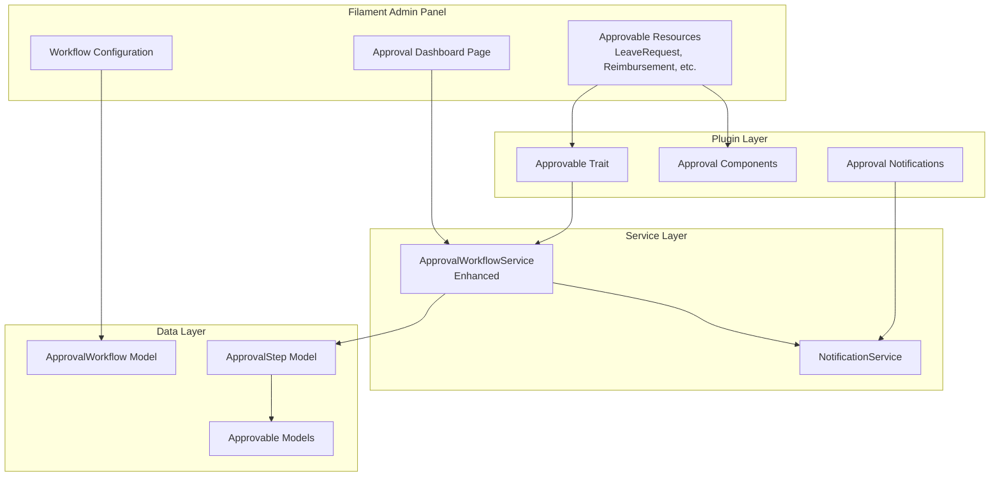

# Design Document: Filament Approvals Plugin Integration

## Overview

This design document outlines the integration of the `ffhs-it/filament-approvals` plugin into the existing HRIS approval workflow system. The integration will enhance the approval experience with standardized UI components while preserving existing business logic and data structures.

The approach is to adopt the plugin's UI components and workflow patterns while maintaining backward compatibility with existing approval data and custom business rules for Indonesian labor law compliance.

## Architecture

### High-Level Architecture



### Integration Strategy

The integration follows a hybrid approach:

1. **Adopt Plugin UI Components**: Use the plugin's approval action buttons, status badges, and history display
2. **Preserve Custom Service Layer**: Keep the existing `ApprovalWorkflowService` with enhancements for plugin compatibility
3. **Maintain Data Structure**: Keep existing database schema with minimal modifications
4. **Add Plugin Trait**: Implement the plugin's `Approvable` trait on existing models

## Components and Interfaces

### 1. Enhanced Approvable Models

Models that require approval will implement the plugin's trait while maintaining existing relationships:

```php
interface ApprovableContract
{
    public function approvalSteps(): HasMany;
    public function currentApprovalStep(): ?ApprovalStep;
    public function isApproved(): bool;
    public function isPending(): bool;
    public function isRejected(): bool;
    public function getApprovalHistory(): Collection;
}
```

**Affected Models:**

-   `App\Models\Hris\LeaveRequest`
-   `App\Models\Hris\Reimbursement`
-   `App\Models\Hris\PayrollRecord` (for adjustments)

### 2. Enhanced ApprovalWorkflowService

```php
interface ApprovalWorkflowServiceInterface
{
    // Existing methods (preserved)
    public function initializeWorkflow(Model $approvable, string $module): void;
    public function getCurrentStep(Model $approvable): ?ApprovalStep;
    public function getSteps(Model $approvable): Collection;
    public function approve(ApprovalStep $step, User $approver, ?string $notes = null): void;
    public function reject(ApprovalStep $step, User $approver, string $reason): void;

    // New methods for plugin integration
    public function getPendingApprovalsForUser(User $user): Collection;
    public function getPendingApprovalsByModule(User $user, string $module): Collection;
    public function bulkApprove(array $stepIds, User $approver, ?string $notes = null): array;
    public function getApprovalStatistics(User $user): array;
}
```

### 3. Approval Dashboard Page

A new Filament page for centralized approval management:

```php
class ApprovalDashboard extends Page
{
    protected static ?string $navigationIcon = 'heroicon-o-clipboard-document-check';
    protected static ?string $navigationGroup = 'HRIS';
    protected static ?int $navigationSort = 5;

    // Methods
    public function getPendingApprovals(): Collection;
    public function getApprovalsByModule(string $module): Collection;
    public function approveSelected(array $ids): void;
    public function rejectSelected(array $ids, string $reason): void;
}
```

### 4. Approval Action Components

Filament action components for resource pages:

```php
// ApproveAction - Filament table/form action
class ApproveAction extends Action
{
    public function setUp(): void;
    protected function getModalHeading(): string;
    protected function getModalDescription(): string;
    protected function getFormSchema(): array; // Notes field
    protected function handle(Model $record, array $data): void;
}

// RejectAction - Filament table/form action
class RejectAction extends Action
{
    public function setUp(): void;
    protected function getModalHeading(): string;
    protected function getFormSchema(): array; // Reason field (required)
    protected function handle(Model $record, array $data): void;
}
```

## Data Models

### Existing Models (Preserved)

#### ApprovalWorkflow

```
approval_workflows
├── id: bigint (PK)
├── name: string
├── for_module: enum('leave', 'reimbursement', 'payroll_adjustment')
├── steps: json
├── is_active: boolean
├── created_at: timestamp
└── updated_at: timestamp
```

#### ApprovalStep

```
approval_steps
├── id: bigint (PK)
├── workflow_id: bigint (FK -> approval_workflows)
├── approvable_type: string (morph)
├── approvable_id: bigint (morph)
├── step_order: integer
├── approver_id: bigint (FK -> users, nullable)
├── approver_role: string (nullable)
├── status: enum('pending', 'approved', 'rejected', 'skipped')
├── approved_at: timestamp (nullable)
├── notes: text (nullable)
├── created_at: timestamp
└── updated_at: timestamp
```

### New/Modified Fields

No new tables required. Minor additions to existing models:

```php
// Add to approvable models (LeaveRequest, Reimbursement)
// These fields may already exist
- approval_status: enum('pending', 'approved', 'rejected')
- approved_at: timestamp (nullable)
- rejected_at: timestamp (nullable)
- rejection_reason: text (nullable)
```

## Correctness Properties

_A property is a characteristic or behavior that should hold true across all valid executions of a system-essentially, a formal statement about what the system should do. Properties serve as the bridge between human-readable specifications and machine-verifiable correctness guarantees._

### Property 1: Approval action buttons presence

_For any_ approvable resource page viewed by an authorized approver, the page SHALL contain approve and reject action buttons when the item is pending their approval.
**Validates: Requirements 1.1**

### Property 2: Approval history completeness

_For any_ approval step that has been processed (approved or rejected), the history display SHALL include the approver name, timestamp, and notes.
**Validates: Requirements 1.4**

### Property 3: Approver type resolution

_For any_ workflow step configured with a role-based approver, the system SHALL resolve to a user with that role; for user-based approvers, the system SHALL use the specified user ID.
**Validates: Requirements 2.3**

### Property 4: Sequential step execution

_For any_ workflow with multiple steps, approval of step N SHALL advance the workflow to step N+1, and step N+1 SHALL not be actionable until step N is approved.
**Validates: Requirements 2.4**

### Property 5: Approver notification on step advancement

_For any_ approval step that becomes pending, a notification SHALL be created for the designated approver within the same transaction.
**Validates: Requirements 3.1**

### Property 6: Pending count accuracy

_For any_ user with approver privileges, the navigation badge count SHALL equal the count of approval steps where that user is the designated approver and status is pending.
**Validates: Requirements 3.2**

### Property 7: Requestor notification on status change

_For any_ approval or rejection action, a notification SHALL be created for the original requestor indicating the new status.
**Validates: Requirements 3.3**

### Property 8: Dashboard pending items completeness

_For any_ approver accessing the approval dashboard, the displayed items SHALL include all approval steps where they are the designated approver and status is pending.
**Validates: Requirements 5.1**

### Property 9: Module filter correctness

_For any_ module filter applied to pending approvals, the returned items SHALL only include approvables of that module type.
**Validates: Requirements 5.2**

### Property 10: Bulk approval atomicity

_For any_ bulk approval action on N items, either all N items SHALL be approved successfully, or none SHALL be modified (transaction rollback on failure).
**Validates: Requirements 5.4**

### Property 11: Workflow modification isolation

_For any_ workflow modification, existing in-progress approvals SHALL continue using their original workflow configuration, and only new requests SHALL use the modified workflow.
**Validates: Requirements 6.3**

### Property 12: Active workflow selection

_For any_ new approvable item, the system SHALL initialize the workflow using only the active workflow for that module, ignoring inactive workflows.
**Validates: Requirements 6.4**

## Error Handling

### Approval Errors

| Error Condition              | Handling Strategy                                            |
| ---------------------------- | ------------------------------------------------------------ |
| Unauthorized approver        | Throw `UnauthorizedApprovalException`, display error message |
| Step already processed       | Throw `StepAlreadyProcessedException`, refresh UI            |
| No active workflow           | Use default single-step approval or skip workflow            |
| Approver user not found      | Log warning, allow role-based fallback                       |
| Database transaction failure | Rollback all changes, display error notification             |

### Validation Errors

| Error Condition        | Handling Strategy                                         |
| ---------------------- | --------------------------------------------------------- |
| Empty rejection reason | Require reason field, show validation error               |
| Invalid step order     | Validate on workflow save, prevent invalid configurations |
| Circular workflow      | Detect and prevent during configuration                   |

## Testing Strategy

### Dual Testing Approach

The implementation will use both unit tests and property-based tests:

**Unit Tests (Pest PHP)**

-   Test specific approval scenarios (approve, reject, skip)
-   Test notification creation
-   Test UI component rendering
-   Test migration scripts

**Property-Based Tests (Pest PHP with faker-based generation)**

-   Test workflow step sequencing across random configurations
-   Test approver resolution for various role/user combinations
-   Test filter correctness with random module types
-   Test bulk operations with varying batch sizes

### Property-Based Testing Library

Use Pest PHP with custom generators for:

-   Random workflow configurations
-   Random approvable items
-   Random user/role combinations

Each property-based test will run a minimum of 100 iterations.

### Test Organization

```
tests/
├── Feature/
│   └── Hris/
│       ├── ApprovalDashboardTest.php
│       ├── ApprovalActionTest.php
│       ├── ApprovalWorkflowPropertyTest.php (existing, enhanced)
│       └── BulkApprovalPropertyTest.php
└── Unit/
    └── Hris/
        └── ApprovalWorkflowServiceTest.php
```

### Test Annotations

Each property-based test must include:

```php
/**
 * Feature: filament-approvals-integration, Property {N}: {property_text}
 * Validates: Requirements {X.Y}
 */
```
