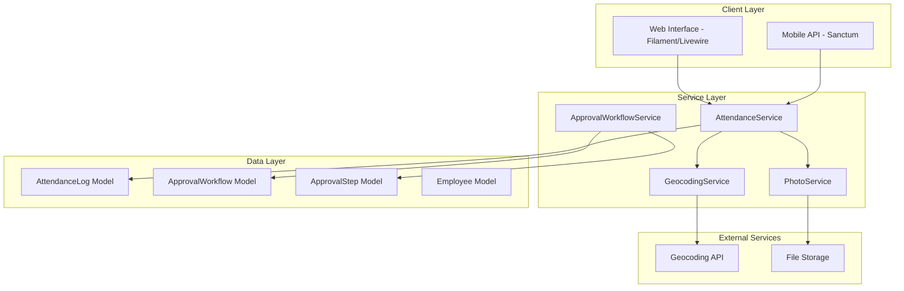
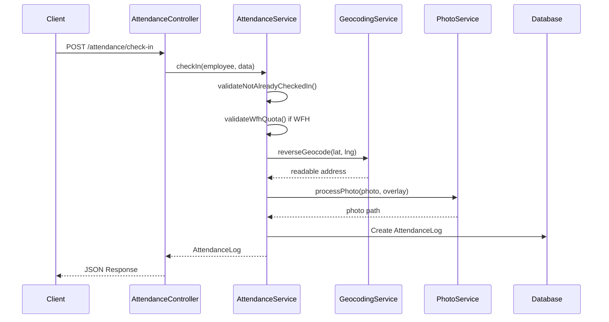

# Design Document: HRIS Phase 2 - Attendance & Approval Workflow

## Overview

This design document details the implementation of the Time & Attendance system and Approval Workflow Engine for HRIS Phase 2. The system enables employees to record their attendance via web and mobile interfaces with GPS coordinates and timestamped photos, supports Work From Home (WFH) mode with weekly quota management, and provides a configurable multi-step approval workflow engine.

The implementation follows existing Laravel/Filament patterns established in Phase 1, integrating with the existing Employee, LeaveRequest, and notification systems.

## Architecture

### System Components



### Request Flow - Check-In



## Components and Interfaces

### 1. AttendanceLog Model

**Location:** `app/Models/Hris/AttendanceLog.php`

```php
class AttendanceLog extends Model
{
    const STATUS_PRESENT = 'present';
    const STATUS_LATE = 'late';
    const STATUS_HALF_DAY = 'half_day';
    const STATUS_ABSENT = 'absent';
    const STATUS_LEAVE = 'leave';
    const STATUS_HOLIDAY = 'holiday';

    const MODE_OFFICE = 'office';
    const MODE_WFH = 'wfh';

    const SOURCE_WEB = 'web';
    const SOURCE_MOBILE = 'mobile';
    const SOURCE_BIOMETRIC = 'biometric';

    protected $fillable = [
        'employee_id', 'date', 'mode',
        'check_in_time', 'check_in_latitude', 'check_in_longitude',
        'check_in_address', 'check_in_photo_path',
        'check_out_time', 'check_out_latitude', 'check_out_longitude',
        'check_out_address', 'check_out_photo_path',
        'source', 'status', 'metadata'
    ];
}
```

### 2. ApprovalWorkflow Model

**Location:** `app/Models/Hris/ApprovalWorkflow.php`

```php
class ApprovalWorkflow extends Model
{
    const MODULE_LEAVE = 'leave';
    const MODULE_REIMBURSEMENT = 'reimbursement';
    const MODULE_PAYROLL_ADJUSTMENT = 'payroll_adjustment';

    protected $fillable = ['name', 'for_module', 'steps', 'is_active'];

    protected $casts = ['steps' => 'array', 'is_active' => 'boolean'];
}
```

### 3. ApprovalStep Model

**Location:** `app/Models/Hris/ApprovalStep.php`

```php
class ApprovalStep extends Model
{
    const STATUS_PENDING = 'pending';
    const STATUS_APPROVED = 'approved';
    const STATUS_REJECTED = 'rejected';
    const STATUS_SKIPPED = 'skipped';

    protected $fillable = [
        'workflow_id', 'approvable_type', 'approvable_id',
        'step_order', 'approver_id', 'approver_role',
        'status', 'approved_at', 'notes'
    ];
}
```

### 4. AttendanceService

**Location:** `app/Services/Hris/AttendanceService.php`

```php
interface AttendanceServiceInterface
{
    public function checkIn(Employee $employee, array $data): AttendanceLog;
    public function checkOut(Employee $employee, array $data): AttendanceLog;
    public function getTodayAttendance(Employee $employee): ?AttendanceLog;
    public function getHistory(Employee $employee, Carbon $from, Carbon $to): Collection;
    public function getRemainingWfhQuota(Employee $employee): int;
    public function computeStatus(AttendanceLog $log): string;
}
```

### 5. GeocodingService

**Location:** `app/Services/Hris/GeocodingService.php`

```php
interface GeocodingServiceInterface
{
    public function reverseGeocode(float $latitude, float $longitude): string;
}
```

### 6. PhotoService

**Location:** `app/Services/Hris/PhotoService.php`

```php
interface PhotoServiceInterface
{
    public function processAttendancePhoto(
        UploadedFile $photo,
        string $clockType, // 'in' or 'out'
        Carbon $time,
        string $address
    ): string; // Returns stored file path
}
```

### 7. ApprovalWorkflowService

**Location:** `app/Services/Hris/ApprovalWorkflowService.php`

```php
interface ApprovalWorkflowServiceInterface
{
    public function initializeWorkflow(Model $approvable, string $module): void;
    public function approve(ApprovalStep $step, User $approver, ?string $notes = null): void;
    public function reject(ApprovalStep $step, User $approver, string $reason): void;
    public function getCurrentStep(Model $approvable): ?ApprovalStep;
}
```

### 8. API Controllers

**Location:** `app/Http/Controllers/Api/Hris/AttendanceController.php`

| Endpoint                         | Method | Description                              |
| -------------------------------- | ------ | ---------------------------------------- |
| `/api/hris/attendance/check-in`  | POST   | Record check-in with GPS, photo, mode    |
| `/api/hris/attendance/check-out` | POST   | Record check-out with GPS, photo         |
| `/api/hris/attendance/daily`     | GET    | Get today's attendance                   |
| `/api/hris/attendance/history`   | GET    | Get attendance history (date range)      |
| `/api/hris/attendance/wfh-quota` | GET    | Get remaining WFH quota for current week |

### 9. Filament Resources

| Resource                   | Purpose                                |
| -------------------------- | -------------------------------------- |
| `AttendanceLogResource`    | HR admin view/filter/export attendance |
| `ApprovalWorkflowResource` | Configure approval workflow templates  |

## Data Models

### attendance_logs Table

| Column               | Type          | Description                                                 |
| -------------------- | ------------- | ----------------------------------------------------------- |
| id                   | bigint        | Primary key                                                 |
| employee_id          | bigint        | FK to employees                                             |
| date                 | date          | Attendance date                                             |
| mode                 | enum          | 'office', 'wfh'                                             |
| check_in_time        | datetime      | Check-in timestamp                                          |
| check_in_latitude    | decimal(10,8) | GPS latitude                                                |
| check_in_longitude   | decimal(11,8) | GPS longitude                                               |
| check_in_address     | string        | Reverse geocoded address                                    |
| check_in_photo_path  | string        | Path to timestamped photo                                   |
| check_out_time       | datetime      | Check-out timestamp                                         |
| check_out_latitude   | decimal(10,8) | GPS latitude                                                |
| check_out_longitude  | decimal(11,8) | GPS longitude                                               |
| check_out_address    | string        | Reverse geocoded address                                    |
| check_out_photo_path | string        | Path to timestamped photo                                   |
| source               | enum          | 'web', 'mobile', 'biometric'                                |
| status               | enum          | 'present', 'late', 'half_day', 'absent', 'leave', 'holiday' |
| metadata             | json          | Additional data                                             |
| created_at           | timestamp     |                                                             |
| updated_at           | timestamp     |                                                             |

### approval_workflows Table

| Column     | Type      | Description                                    |
| ---------- | --------- | ---------------------------------------------- |
| id         | bigint    | Primary key                                    |
| name       | string    | Workflow name                                  |
| for_module | enum      | 'leave', 'reimbursement', 'payroll_adjustment' |
| steps      | json      | Array of step definitions                      |
| is_active  | boolean   | Whether workflow is active                     |
| created_at | timestamp |                                                |
| updated_at | timestamp |                                                |

**Steps JSON Structure:**

```json
[
    { "order": 1, "type": "role", "value": "head_division" },
    { "order": 2, "type": "role", "value": "hr-admin" },
    { "order": 3, "type": "user", "value": 123 }
]
```

### approval_steps Table

| Column          | Type      | Description                                  |
| --------------- | --------- | -------------------------------------------- |
| id              | bigint    | Primary key                                  |
| workflow_id     | bigint    | FK to approval_workflows                     |
| approvable_type | string    | Morph type (LeaveRequest, etc.)              |
| approvable_id   | bigint    | Morph ID                                     |
| step_order      | int       | Order in workflow                            |
| approver_id     | bigint    | FK to users (resolved)                       |
| approver_role   | string    | Original role if role-based                  |
| status          | enum      | 'pending', 'approved', 'rejected', 'skipped' |
| approved_at     | datetime  | When approved/rejected                       |
| notes           | text      | Approver notes                               |
| created_at      | timestamp |                                              |
| updated_at      | timestamp |                                              |

## Correctness Properties

_A property is a characteristic or behavior that should hold true across all valid executions of a system-essentially, a formal statement about what the system should do. Properties serve as the bridge between human-readable specifications and machine-verifiable correctness guarantees._

### Property 1: Check-in creates AttendanceLog with correct data

_For any_ employee and valid check-in data (timestamp, source, mode, optional GPS), performing a check-in SHALL result in an AttendanceLog record being created with the exact timestamp, source, and mode provided.

**Validates: Requirements 1.1, 1.10**

### Property 2: Check-out updates existing AttendanceLog

_For any_ employee with an existing check-in for the day, performing a check-out SHALL update that AttendanceLog record with the check-out timestamp without creating a new record.

**Validates: Requirements 1.2**

### Property 3: Duplicate check-in rejection

_For any_ employee who has already checked in for the current day, attempting another check-in SHALL be rejected and the existing AttendanceLog SHALL remain unchanged.

**Validates: Requirements 1.3**

### Property 4: Check-out without check-in rejection

_For any_ employee who has not checked in for the current day, attempting a check-out SHALL be rejected and no AttendanceLog record SHALL be created or modified.

**Validates: Requirements 1.4**

### Property 5: GPS coordinates storage

_For any_ check-in or check-out with GPS coordinates provided, the latitude and longitude values SHALL be stored in the corresponding AttendanceLog fields with the exact values provided.

**Validates: Requirements 1.5, 1.6**

### Property 6: Photo storage with timestamp overlay

_For any_ check-in or check-out with a photo provided, the system SHALL store the photo and the resulting file path SHALL be recorded in the AttendanceLog. The overlay SHALL contain the clock type ("Clock in" or "Clock out"), time in HH:MM format, and the readable address.

**Validates: Requirements 1.7, 1.8**

### Property 7: Reverse geocoding produces readable address

_For any_ GPS coordinates provided during check-in or check-out, the system SHALL perform reverse geocoding and store a human-readable address containing building/location name, street, and city.

**Validates: Requirements 1.9**

### Property 8: WFH quota validation

_For any_ employee selecting WFH mode during check-in, if the employee has already used their WFH quota for the current week (1 day), the check-in SHALL be rejected.

**Validates: Requirements 1.11, 1.12**

### Property 9: WFH quota decrement

_For any_ successful WFH check-in, the employee's remaining WFH quota for the current week SHALL decrease by exactly 1.

**Validates: Requirements 1.13**

### Property 10: WFH quota weekly reset

_For any_ employee, the WFH quota SHALL be calculated as 1 minus the number of WFH days used in the current week (Monday to Sunday). Unused quota from previous weeks SHALL NOT carry over.

**Validates: Requirements 1.14**

### Property 11: Attendance history filtering and ordering

_For any_ employee and date range, requesting attendance history SHALL return only AttendanceLogs within that range, ordered by date descending.

**Validates: Requirements 2.2**

### Property 12: Attendance status computation

_For any_ AttendanceLog, the computed status SHALL be included when retrieving attendance data, based on check-in time, check-out time, and any associated leave records.

**Validates: Requirements 2.3**

### Property 13: HR filter accuracy

_For any_ filter criteria (employee, date range, status) applied by an HR administrator, the returned AttendanceLogs SHALL contain only records matching ALL specified criteria.

**Validates: Requirements 3.2**

### Property 14: Approval workflow storage

_For any_ ApprovalWorkflow created with a name, module type, and step definitions, all provided data SHALL be stored and retrievable with exact values.

**Validates: Requirements 4.1, 4.2**

### Property 15: Workflow instantiation

_For any_ approvable item (LeaveRequest, Reimbursement) submitted with an applicable ApprovalWorkflow, the system SHALL create ApprovalStep records matching the workflow's step definitions with the first step marked as pending.

**Validates: Requirements 5.1**

### Property 16: Approval progression

_For any_ ApprovalStep that is approved, if there are remaining steps, the next step SHALL become pending. If it is the final step, the approvable item SHALL be marked as approved.

**Validates: Requirements 5.2, 5.3**

### Property 17: Rejection terminates workflow

_For any_ ApprovalStep that is rejected, the approvable item SHALL be marked as rejected and no further steps SHALL be processed.

**Validates: Requirements 5.4**

### Property 18: Team attendance scope

_For any_ manager viewing team attendance, the returned data SHALL include only employees who are direct reports of that manager.

**Validates: Requirements 6.1**

## Error Handling

### Attendance Errors

| Error Code                | Condition                                          | Response                              |
| ------------------------- | -------------------------------------------------- | ------------------------------------- |
| `ALREADY_CHECKED_IN`      | Employee attempts check-in when already checked in | 422 Unprocessable Entity              |
| `NOT_CHECKED_IN`          | Employee attempts check-out without check-in       | 422 Unprocessable Entity              |
| `WFH_QUOTA_EXCEEDED`      | Employee attempts WFH when quota exhausted         | 422 Unprocessable Entity              |
| `INVALID_COORDINATES`     | GPS coordinates out of valid range                 | 422 Unprocessable Entity              |
| `GEOCODING_FAILED`        | Reverse geocoding service unavailable              | Log warning, continue without address |
| `PHOTO_PROCESSING_FAILED` | Photo processing fails                             | 422 Unprocessable Entity              |

### Approval Workflow Errors

| Error Code                | Condition                           | Response                   |
| ------------------------- | ----------------------------------- | -------------------------- |
| `NO_WORKFLOW_FOUND`       | No active workflow for module       | Use default approver logic |
| `NOT_AUTHORIZED_APPROVER` | User not authorized to approve step | 403 Forbidden              |
| `STEP_ALREADY_PROCESSED`  | Step already approved/rejected      | 422 Unprocessable Entity   |
| `INVALID_WORKFLOW_STEPS`  | Workflow steps JSON malformed       | 422 Unprocessable Entity   |

## Testing Strategy

### Property-Based Testing

**Library:** Pest PHP with `pestphp/pest-plugin-faker` for data generation

Property-based tests will be implemented for all correctness properties using generated test data:

1. **AttendanceService Properties** (Properties 1-12)

    - Generate random employees, timestamps, GPS coordinates
    - Test check-in/check-out state transitions
    - Test WFH quota calculations across week boundaries

2. **ApprovalWorkflowService Properties** (Properties 14-17)

    - Generate random workflow configurations
    - Test approval/rejection state machines
    - Test step progression logic

3. **Query/Filter Properties** (Properties 11, 13, 18)
    - Generate diverse attendance data
    - Test filter combinations return correct subsets

### Unit Tests

Unit tests will cover:

-   Model relationships and scopes
-   Service method edge cases
-   API request validation
-   Filament resource configuration

### Test Annotations

Each property-based test MUST include a comment referencing the design property:

```php
/**
 * Feature: hris-phase2-attendance, Property 1: Check-in creates AttendanceLog with correct data
 * Validates: Requirements 1.1, 1.10
 */
```

### Test Configuration

Property-based tests will run a minimum of 100 iterations to ensure adequate coverage of the input space.
