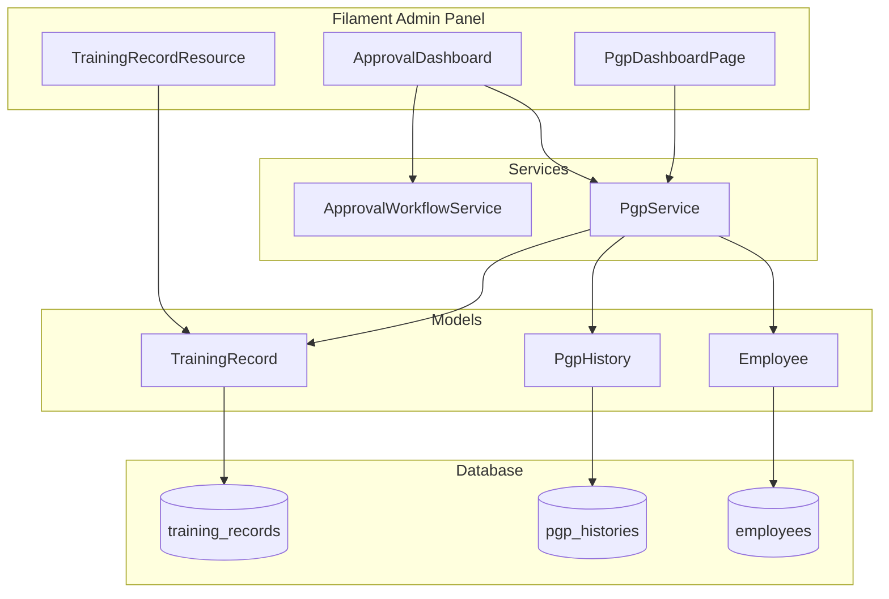
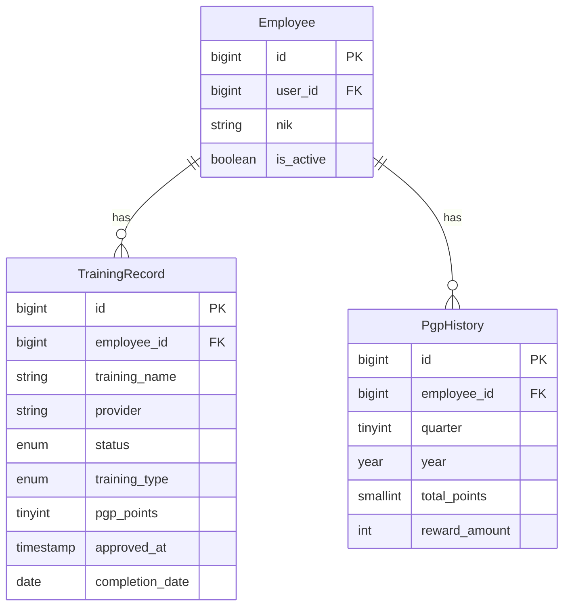

# Design Document: Homefinder Growth Point (PGP) System

## Overview

The Homefinder Growth Point (PGP) System is a quarterly-based employee reward mechanism that incentivizes training completion. This design extends the existing Training Record system and integrates with the Approval Dashboard to provide a comprehensive PGP tracking and reward calculation solution.

The system follows a quarterly cycle (Q1-Q4) where employees accumulate PGP points through approved training completions. Points are awarded based on training type: 35 PGP for free (company-provided) training and 15-25 PGP for paid (external/certification) training. Upon reaching the 150 PGP quarterly target, employees earn a base reward of Rp150,000, with additional Rp35,000 for each complete 35-point block beyond the target.

## Architecture



### Component Responsibilities

1. **PgpService**: Core business logic for PGP calculations, reward computation, and quarterly management
2. **TrainingRecordResource**: Enhanced to include training type and PGP point management
3. **ApprovalDashboard**: Modified to handle PGP point input during training approval
4. **PgpDashboardPage**: New Filament page for employee PGP progress visualization

## Components and Interfaces

### PgpService

The central service handling all PGP-related business logic.

```php
<?php

namespace App\Services\Hris;

class PgpService
{
    /**
     * Get the current quarterly period boundaries.
     *
     * @return array{start: Carbon, end: Carbon, quarter: int, year: int}
     */
    public function getCurrentQuarter(): array;

    /**
     * Get quarterly period for a specific date.
     *
     * @param Carbon $date
     * @return array{start: Carbon, end: Carbon, quarter: int, year: int}
     */
    public function getQuarterForDate(Carbon $date): array;

    /**
     * Calculate total PGP points for an employee in the current quarter.
     *
     * @param Employee $employee
     * @return int
     */
    public function getQuarterlyPoints(Employee $employee): int;

    /**
     * Calculate total PGP points for an employee in a specific quarter.
     *
     * @param Employee $employee
     * @param int $quarter (1-4)
     * @param int $year
     * @return int
     */
    public function getPointsForQuarter(Employee $employee, int $quarter, int $year): int;

    /**
     * Calculate projected reward based on PGP points.
     *
     * @param int $totalPoints
     * @return int Amount in Rupiah
     */
    public function calculateReward(int $totalPoints): int;

    /**
     * Get PGP points value for a training type.
     *
     * @param string $trainingType 'free' or 'paid'
     * @param int|null $customPoints Required for 'paid' type
     * @return int
     * @throws InvalidArgumentException
     */
    public function getPointsForTrainingType(string $trainingType, ?int $customPoints = null): int;

    /**
     * Validate PGP points for paid training.
     *
     * @param int $points
     * @return bool
     */
    public function validatePaidTrainingPoints(int $points): bool;

    /**
     * Award PGP points to an employee for approved training.
     *
     * @param TrainingRecord $trainingRecord
     * @param int $points
     * @return void
     */
    public function awardPoints(TrainingRecord $trainingRecord, int $points): void;

    /**
     * Get approved training records for an employee in current quarter.
     *
     * @param Employee $employee
     * @return Collection<TrainingRecord>
     */
    public function getQuarterlyTrainingRecords(Employee $employee): Collection;

    /**
     * Get progress percentage toward 150 PGP target.
     *
     * @param int $currentPoints
     * @return float (0-100, capped at 100)
     */
    public function getProgressPercentage(int $currentPoints): float;
}
```

### PgpDashboardPage

New Filament page for employee PGP visualization.

```php
<?php

namespace App\Filament\Pages;

class PgpDashboardPage extends Page
{
    /**
     * Get current quarter PGP summary for the logged-in employee.
     *
     * @return array{
     *   currentPoints: int,
     *   targetPoints: int,
     *   progressPercentage: float,
     *   projectedReward: int,
     *   quarter: int,
     *   year: int
     * }
     */
    public function getPgpSummary(): array;

    /**
     * Get list of approved training records with PGP for current quarter.
     *
     * @return Collection<TrainingRecord>
     */
    public function getApprovedTrainings(): Collection;
}
```

### TrainingRecord Model Extensions

```php
<?php

// New constants
const TRAINING_TYPE_FREE = 'free';
const TRAINING_TYPE_PAID = 'paid';

const PGP_FREE_TRAINING = 35;
const PGP_PAID_MIN = 15;
const PGP_PAID_MAX = 25;

// New methods
public function isPaidTraining(): bool;
public function isFreeTraining(): bool;
public function isApprovedForPgp(): bool;

// New scopes
public function scopeApprovedInQuarter(Builder $query, int $quarter, int $year): Builder;
public function scopeWithPgpPoints(Builder $query): Builder;
```

## Data Models

### TrainingRecord Model Updates

Add the following fields to the existing `training_records` table:

```php
Schema::table('training_records', function (Blueprint $table) {
    $table->enum('training_type', ['free', 'paid'])->default('free')->after('status');
    $table->unsignedTinyInteger('pgp_points')->nullable()->after('training_type');
    $table->timestamp('approved_at')->nullable()->after('pgp_points');
});
```

| Field         | Type                 | Description                                      |
| ------------- | -------------------- | ------------------------------------------------ |
| training_type | enum('free', 'paid') | Classification of training                       |
| pgp_points    | tinyint unsigned     | PGP points awarded (35 for free, 15-25 for paid) |
| approved_at   | timestamp            | When the training was approved for PGP           |

### PgpHistory Model (Optional - for historical tracking)

For preserving quarterly snapshots:

```php
Schema::create('pgp_histories', function (Blueprint $table) {
    $table->id();
    $table->foreignId('employee_id')->constrained()->onDelete('cascade');
    $table->unsignedTinyInteger('quarter'); // 1-4
    $table->year('year');
    $table->unsignedSmallInteger('total_points');
    $table->unsignedInteger('reward_amount'); // in Rupiah
    $table->timestamps();

    $table->unique(['employee_id', 'quarter', 'year']);
});
```

### Entity Relationship Diagram



### Reward Calculation Formula

```
Base Reward = Rp150,000 (when total >= 150)
Incremental Blocks = floor((total - 150) / 35)
Incremental Reward = Incremental Blocks × Rp35,000
Total Reward = Base Reward + Incremental Reward

Examples:
- 100 PGP → Rp0 (below target)
- 150 PGP → Rp150,000 (base only)
- 184 PGP → Rp150,000 (34 extra points, no full block)
- 185 PGP → Rp185,000 (35 extra = 1 block)
- 220 PGP → Rp220,000 (70 extra = 2 blocks)
```

## Correctness Properties

_A property is a characteristic or behavior that should hold true across all valid executions of a system—essentially, a formal statement about what the system should do. Properties serve as the bridge between human-readable specifications and machine-verifiable correctness guarantees._

### Property 1: Quarter Determination

_For any_ date within a calendar year, the `getQuarterForDate()` function SHALL correctly identify the quarter as Q1 (Jan-Mar), Q2 (Apr-Jun), Q3 (Jul-Sep), or Q4 (Oct-Dec), and return accurate start/end boundaries.

**Validates: Requirements 1.1**

### Property 2: Quarterly Point Filtering

_For any_ collection of TrainingRecords with various `approved_at` timestamps, the `getQuarterlyPoints()` function SHALL only sum PGP points from records where `approved_at` falls within the specified quarter boundaries.

**Validates: Requirements 1.2, 1.3**

### Property 3: Free Training Fixed Points

_For any_ TrainingRecord with `training_type = 'free'`, the `getPointsForTrainingType()` function SHALL always return exactly 35 PGP points.

**Validates: Requirements 2.1**

### Property 4: Paid Training Validation

_For any_ integer value, the `validatePaidTrainingPoints()` function SHALL return true if and only if the value is between 15 and 25 inclusive.

**Validates: Requirements 2.3, 2.4**

### Property 5: Reward Calculation with Floor Logic

_For any_ non-negative integer representing total PGP points:

- If points < 150, reward SHALL be 0
- If points >= 150, reward SHALL be 150000 + floor((points - 150) / 35) \* 35000

This ensures partial 35-point blocks do not contribute to incremental rewards.

**Validates: Requirements 3.1, 3.2, 3.3, 3.4, 3.5**

### Property 6: Progress Percentage Calculation

_For any_ non-negative integer representing current PGP points, the `getProgressPercentage()` function SHALL return `min(100, (points / 150) * 100)`, capped at 100%.

**Validates: Requirements 5.2**

### Property 7: Approval Recording Completeness

_For any_ TrainingRecord that is approved, the `awardPoints()` function SHALL set both `pgp_points` to the awarded value and `approved_at` to the current timestamp.

**Validates: Requirements 4.4, 6.5**

## Error Handling

### Validation Errors

| Error Condition                 | Response                                                                |
| ------------------------------- | ----------------------------------------------------------------------- |
| Paid training PGP points < 15   | Validation error: "PGP points must be at least 15"                      |
| Paid training PGP points > 25   | Validation error: "PGP points cannot exceed 25"                         |
| Missing training_type on record | Validation error: "Training type is required"                           |
| Approval without employee       | Validation error: "Training record must be associated with an employee" |

### Business Logic Errors

| Error Condition                                         | Response                                                                      |
| ------------------------------------------------------- | ----------------------------------------------------------------------------- |
| Attempt to award points to non-completed training       | Reject with message: "Training must be completed before awarding PGP"         |
| Attempt to re-award points to already approved training | Reject with message: "PGP points have already been awarded for this training" |

### Edge Cases

| Scenario                                         | Handling                                                                   |
| ------------------------------------------------ | -------------------------------------------------------------------------- |
| Employee with no training records                | Return 0 points, 0% progress, Rp0 reward                                   |
| Training approved on quarter boundary (midnight) | Use `approved_at` timestamp; belongs to new quarter if exactly at boundary |
| Negative PGP points input                        | Reject at validation layer                                                 |

## Testing Strategy

### Dual Testing Approach

This feature requires both unit tests and property-based tests for comprehensive coverage:

- **Unit tests**: Verify specific examples, edge cases, and integration points
- **Property tests**: Verify universal properties across randomized inputs

### Property-Based Testing Configuration

- **Library**: Pest PHP with `pestphp/pest-plugin-faker` for data generation
- **Minimum iterations**: 100 per property test
- **Tag format**: `Feature: pgp-system, Property {number}: {property_text}`

### Test Categories

#### Unit Tests

1. **PgpService Unit Tests**
    - Quarter boundary edge cases (Dec 31 → Jan 1, Mar 31 → Apr 1, etc.)
    - Reward calculation specific examples (0, 149, 150, 151, 185, 220 points)
    - Integration with TrainingRecord model

2. **Approval Dashboard Integration Tests**
    - PGP input field visibility for paid training
    - Auto-population of 35 PGP for free training
    - Validation error display

3. **PgpDashboardPage Tests**
    - Progress bar rendering
    - Training list display
    - Reward display formatting

#### Property Tests

Each correctness property (1-7) will have a corresponding property-based test that:

- Generates random valid inputs
- Verifies the property holds for all generated cases
- Runs minimum 100 iterations

### Test File Organization

```
tests/
├── Unit/
│   └── Hris/
│       └── PgpServiceTest.php
├── Feature/
│   └── Hris/
│       ├── PgpDashboardPageTest.php
│       └── TrainingApprovalPgpTest.php
```

### Example Property Test Structure

```php
// Feature: pgp-system, Property 5: Reward Calculation with Floor Logic
it('calculates reward correctly for any point total', function () {
    $points = fake()->numberBetween(0, 500);

    $service = new PgpService();
    $reward = $service->calculateReward($points);

    if ($points < 150) {
        expect($reward)->toBe(0);
    } else {
        $expected = 150000 + (int) floor(($points - 150) / 35) * 35000;
        expect($reward)->toBe($expected);
    }
})->repeat(100);
```
