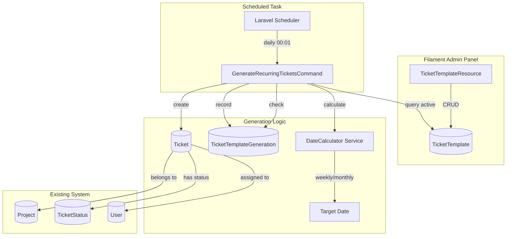
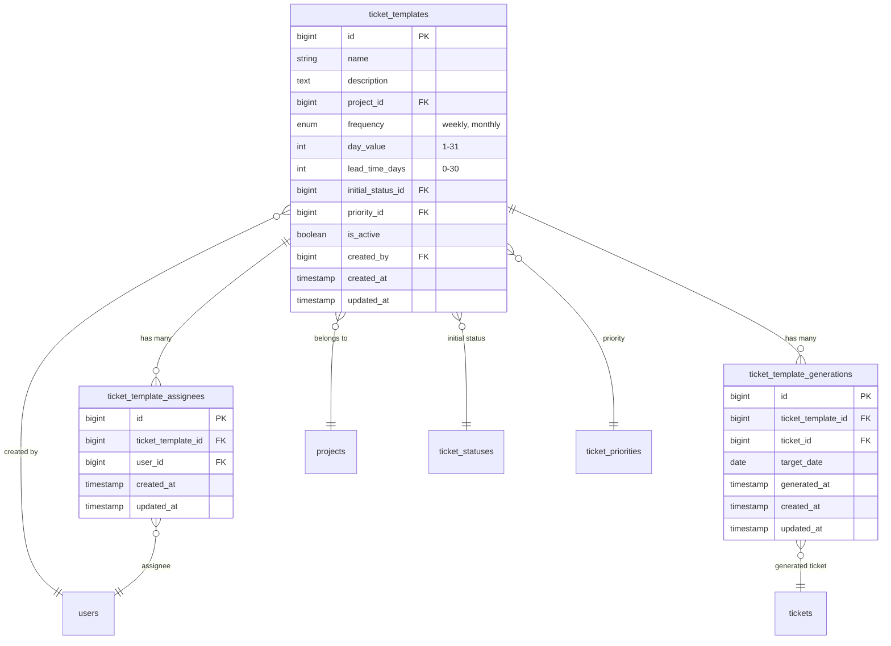

# Design Document: Multi-Department Recurring Tickets

## Overview

The Multi-Department Recurring Tickets feature enables automated ticket generation for recurring tasks across HR, Finance, and Tax departments. The system uses a template-based approach where administrators define ticket templates with scheduling rules, and a daily scheduled command generates tickets based on lead time calculations.

The core innovation is the lead time calculation: `if (today + lead_time_days == target_date) { create_ticket() }`. This ensures teams receive tickets early enough to complete them by the deadline.

## Architecture



## Components and Interfaces

### 1. TicketTemplate Model

The core model storing recurring ticket definitions.

```php
<?php

namespace App\Models;

use Illuminate\Database\Eloquent\Model;
use Illuminate\Database\Eloquent\Relations\BelongsTo;
use Illuminate\Database\Eloquent\Relations\BelongsToMany;
use Illuminate\Database\Eloquent\Relations\HasMany;

class TicketTemplate extends Model
{
    protected $fillable = [
        'name',
        'description',
        'project_id',
        'frequency',        // 'weekly' or 'monthly'
        'day_value',        // 1-7 for weekly, 1-31 for monthly
        'lead_time_days',   // 0-30 days before target
        'initial_status_id',
        'priority_id',
        'is_active',
        'created_by',
    ];

    protected $casts = [
        'is_active' => 'boolean',
        'day_value' => 'integer',
        'lead_time_days' => 'integer',
    ];

    public function project(): BelongsTo;
    public function initialStatus(): BelongsTo;
    public function priority(): BelongsTo;
    public function creator(): BelongsTo;
    public function assignees(): BelongsToMany;
    public function generations(): HasMany;

    // Calculate next target date based on frequency
    public function getNextTargetDate(): Carbon;

    // Calculate when ticket should be generated (target - lead_time)
    public function getNextGenerationDate(): Carbon;

    // Check if ticket should be generated today
    public function shouldGenerateToday(): bool;

    // Check if already generated for current period
    public function hasGeneratedForPeriod(Carbon $targetDate): bool;
}
```

### 2. TicketTemplateGeneration Model

Tracks generation history for audit and duplicate prevention.

```php
<?php

namespace App\Models;

use Illuminate\Database\Eloquent\Model;
use Illuminate\Database\Eloquent\Relations\BelongsTo;

class TicketTemplateGeneration extends Model
{
    protected $fillable = [
        'ticket_template_id',
        'ticket_id',
        'target_date',
        'generated_at',
    ];

    protected $casts = [
        'target_date' => 'date',
        'generated_at' => 'datetime',
    ];

    public function template(): BelongsTo;
    public function ticket(): BelongsTo;
}
```

### 3. RecurringTicketService

Encapsulates the business logic for date calculations and ticket generation.

```php
<?php

namespace App\Services;

use App\Models\TicketTemplate;
use App\Models\Ticket;
use App\Models\TicketTemplateGeneration;
use Carbon\Carbon;

class RecurringTicketService
{
    /**
     * Calculate the next target date for a template
     */
    public function calculateNextTargetDate(
        string $frequency,
        int $dayValue,
        ?Carbon $fromDate = null
    ): Carbon;

    /**
     * Calculate weekly target date (next occurrence of day_value)
     * day_value: 1=Monday, 7=Sunday
     */
    public function calculateWeeklyTargetDate(
        int $dayOfWeek,
        ?Carbon $fromDate = null
    ): Carbon;

    /**
     * Calculate monthly target date (next occurrence of day_value)
     * Handles months with fewer days (e.g., day 31 in February)
     */
    public function calculateMonthlyTargetDate(
        int $dayOfMonth,
        ?Carbon $fromDate = null
    ): Carbon;

    /**
     * Check if a template should generate a ticket today
     */
    public function shouldGenerateToday(TicketTemplate $template): bool;

    /**
     * Generate a ticket from a template
     */
    public function generateTicket(TicketTemplate $template): Ticket;

    /**
     * Process all active templates and generate due tickets
     */
    public function processAllTemplates(): array;
}
```

### 4. GenerateRecurringTicketsCommand

The Artisan command scheduled to run daily.

```php
<?php

namespace App\Console\Commands;

use App\Services\RecurringTicketService;
use Illuminate\Console\Command;

class GenerateRecurringTicketsCommand extends Command
{
    protected $signature = 'tickets:generate-recurring
                            {--dry-run : Show what would be generated without creating tickets}';

    protected $description = 'Generate tickets from active recurring templates';

    public function handle(RecurringTicketService $service): int;
}
```

### 5. TicketTemplateResource

Filament resource for managing templates.

```php
<?php

namespace App\Filament\Resources;

use App\Models\TicketTemplate;
use Filament\Resources\Resource;

class TicketTemplateResource extends Resource
{
    protected static ?string $model = TicketTemplate::class;
    protected static ?string $navigationIcon = 'heroicon-o-arrow-path';
    protected static ?string $navigationGroup = 'Project Management';

    public static function form(Form $form): Form;
    public static function table(Table $table): Table;
    public static function getRelations(): array;
    public static function getPages(): array;
}
```

### 6. TicketTemplatePolicy

Authorization policy integrated with Filament Shield.

```php
<?php

namespace App\Policies;

use App\Models\User;
use App\Models\TicketTemplate;

class TicketTemplatePolicy
{
    public function viewAny(User $user): bool;
    public function view(User $user, TicketTemplate $template): bool;
    public function create(User $user): bool;
    public function update(User $user, TicketTemplate $template): bool;
    public function delete(User $user, TicketTemplate $template): bool;
}
```

## Data Models

### Database Schema



### Migration: create_ticket_templates_table

```php
Schema::create('ticket_templates', function (Blueprint $table) {
    $table->id();
    $table->string('name');
    $table->text('description')->nullable();
    $table->foreignId('project_id')->constrained()->onDelete('cascade');
    $table->enum('frequency', ['weekly', 'monthly']);
    $table->unsignedTinyInteger('day_value'); // 1-31
    $table->unsignedTinyInteger('lead_time_days')->default(0); // 0-30
    $table->foreignId('initial_status_id')
        ->constrained('ticket_statuses')
        ->onDelete('cascade');
    $table->foreignId('priority_id')
        ->nullable()
        ->constrained('ticket_priorities')
        ->onDelete('set null');
    $table->boolean('is_active')->default(true);
    $table->foreignId('created_by')
        ->nullable()
        ->constrained('users')
        ->onDelete('set null');
    $table->timestamps();

    $table->index(['is_active', 'frequency']);
});
```

### Migration: create_ticket_template_assignees_table

```php
Schema::create('ticket_template_assignees', function (Blueprint $table) {
    $table->id();
    $table->foreignId('ticket_template_id')
        ->constrained()
        ->onDelete('cascade');
    $table->foreignId('user_id')
        ->constrained()
        ->onDelete('cascade');
    $table->timestamps();

    $table->unique(['ticket_template_id', 'user_id']);
});
```

### Migration: create_ticket_template_generations_table

```php
Schema::create('ticket_template_generations', function (Blueprint $table) {
    $table->id();
    $table->foreignId('ticket_template_id')
        ->constrained()
        ->onDelete('cascade');
    $table->foreignId('ticket_id')
        ->constrained()
        ->onDelete('cascade');
    $table->date('target_date');
    $table->timestamp('generated_at');
    $table->timestamps();

    $table->unique(['ticket_template_id', 'target_date']);
    $table->index('target_date');
});
```

### Frequency Enum

```php
<?php

namespace App\Enums;

enum TicketFrequency: string
{
    case Weekly = 'weekly';
    case Monthly = 'monthly';

    public function label(): string
    {
        return match($this) {
            self::Weekly => 'Weekly',
            self::Monthly => 'Monthly',
        };
    }

    public function dayValueLabel(int $value): string
    {
        return match($this) {
            self::Weekly => $this->weekdayName($value),
            self::Monthly => "Day {$value}",
        };
    }

    private function weekdayName(int $day): string
    {
        return match($day) {
            1 => 'Monday',
            2 => 'Tuesday',
            3 => 'Wednesday',
            4 => 'Thursday',
            5 => 'Friday',
            6 => 'Saturday',
            7 => 'Sunday',
            default => 'Unknown',
        };
    }
}
```

## Correctness Properties

_A property is a characteristic or behavior that should hold true across all valid executions of a system—essentially, a formal statement about what the system should do. Properties serve as the bridge between human-readable specifications and machine-verifiable correctness guarantees._

### Property 1: Template Validation

_For any_ ticket template with frequency "weekly", the day_value must be between 1 and 7 (inclusive), and _for any_ template with frequency "monthly", the day_value must be between 1 and 31 (inclusive). Additionally, _for any_ template, lead_time_days must be between 0 and 30 (inclusive). Invalid combinations must be rejected by validation.

**Validates: Requirements 1.2, 1.3**

### Property 2: Generation Trigger Correctness

_For any_ active ticket template and _for any_ date considered as "today", a ticket should be generated if and only if `today + lead_time_days == target_date`. If this condition is false, no ticket should be generated.

**Validates: Requirements 2.2**

### Property 3: Ticket Data Copying

_For any_ ticket generated from a template, the ticket's name, description, project_id, and priority_id must equal the template's corresponding values. The ticket's due_date must equal the calculated target_date. The ticket's ticket_status_id must equal the template's initial_status_id. The ticket's assignees must include all assignees from the template who are still project members.

**Validates: Requirements 2.3, 2.4, 2.5, 2.6**

### Property 4: Generation Idempotence

_For any_ ticket template and _for any_ target_date, running the generation process multiple times for the same period must produce exactly one ticket. Subsequent runs must skip the template and not create duplicate tickets. The generation record (template_id, ticket_id, target_date, generated_at) must exist for each generated ticket.

**Validates: Requirements 2.8, 7.2**

### Property 5: Weekly Target Date Calculation

_For any_ day of week (1-7) and _for any_ current date, the calculated weekly target_date must be the next occurrence of that day of week. If today is the target day, the target_date should be today (not next week). The target_date must always be >= today.

**Validates: Requirements 3.3**

### Property 6: Monthly Target Date Calculation

_For any_ day of month (1-31) and _for any_ current date, the calculated monthly target_date must be the next occurrence of that day. If the target day has passed this month, the target must be next month. If the month has fewer days than day_value (e.g., day 31 in February), the target must be the last day of that month. The target_date must always be >= today.

**Validates: Requirements 4.2, 4.3**

### Property 7: Removed Assignee Handling

_For any_ ticket template where one or more assignees have been removed from the project, ticket generation must still succeed. The generated ticket must only include assignees who are currently project members. The generation must not fail due to missing assignees.

**Validates: Requirements 5.4**

### Property 8: Status Fallback

_For any_ ticket template where the initial_status_id references a deleted TicketStatus, ticket generation must still succeed. The generated ticket must use the project's first status (by sort_order) as a fallback. The generation must not fail due to missing status.

**Validates: Requirements 6.4**

## Error Handling

### Template Validation Errors

| Error Condition                 | Handling Strategy                                                 |
| ------------------------------- | ----------------------------------------------------------------- |
| Invalid day_value for frequency | Return validation error with clear message explaining valid range |
| lead_time_days out of range     | Return validation error specifying 0-30 range                     |
| Project not found               | Return validation error, prevent template creation                |
| Initial status not in project   | Return validation error, show only valid statuses                 |

### Generation Errors

| Error Condition                    | Handling Strategy                                         |
| ---------------------------------- | --------------------------------------------------------- |
| Template's project deleted         | Skip template, log warning, continue with other templates |
| Initial status deleted             | Use project's first status by sort_order as fallback      |
| All assignees removed from project | Generate ticket without assignees, log info               |
| Database transaction failure       | Rollback, log error, continue with other templates        |
| Duplicate generation attempt       | Skip silently (idempotent behavior)                       |

### Command Execution Errors

| Error Condition     | Handling Strategy                                       |
| ------------------- | ------------------------------------------------------- |
| No active templates | Log info, exit successfully                             |
| Service unavailable | Log error, exit with failure code                       |
| Partial failure     | Continue processing remaining templates, report summary |

### Logging Strategy

```php
// Success logging
Log::info('Recurring ticket generated', [
    'template_id' => $template->id,
    'ticket_id' => $ticket->id,
    'target_date' => $targetDate->toDateString(),
]);

// Skip logging
Log::debug('Template skipped - already generated for period', [
    'template_id' => $template->id,
    'target_date' => $targetDate->toDateString(),
]);

// Error logging
Log::error('Failed to generate recurring ticket', [
    'template_id' => $template->id,
    'error' => $exception->getMessage(),
]);
```

## Testing Strategy

### Dual Testing Approach

This feature requires both unit tests and property-based tests for comprehensive coverage:

- **Unit tests**: Verify specific examples, edge cases, and integration points
- **Property tests**: Verify universal properties across randomized inputs

### Property-Based Testing Configuration

- **Library**: Pest PHP with `pestphp/pest-plugin-faker` for data generation
- **Minimum iterations**: 100 per property test
- **Tag format**: `Feature: recurring-tickets, Property {number}: {property_text}`

### Test Organization

```
tests/
├── Feature/
│   └── RecurringTickets/
│       ├── TicketTemplateResourceTest.php      # Filament resource tests
│       ├── GenerateRecurringTicketsCommandTest.php  # Command tests
│       └── RecurringTicketServicePropertyTest.php   # Property tests
└── Unit/
    └── RecurringTickets/
        ├── TicketTemplateModelTest.php         # Model unit tests
        ├── RecurringTicketServiceTest.php      # Service unit tests
        └── DateCalculationTest.php             # Date calculation tests
```

### Property Test Implementation

Each correctness property maps to a property-based test:

1. **Property 1**: Generate random frequency/day_value/lead_time combinations, verify validation
2. **Property 2**: Generate random templates and dates, verify generation trigger logic
3. **Property 3**: Generate random templates, create tickets, verify field copying
4. **Property 4**: Run generation twice for same template/period, verify single ticket
5. **Property 5**: Generate random day_of_week and current_date, verify weekly calculation
6. **Property 6**: Generate random day_of_month and current_date, verify monthly calculation
7. **Property 7**: Generate templates with removed assignees, verify graceful handling
8. **Property 8**: Generate templates with deleted status, verify fallback behavior

### Unit Test Coverage

- Template CRUD operations via Filament resource
- Command execution with various scenarios
- Date calculation edge cases (month boundaries, leap years)
- Permission checks and authorization
- Generation history recording

### Integration Test Coverage

- End-to-end template creation and ticket generation
- Scheduler integration verification
- Filament Shield permission integration
