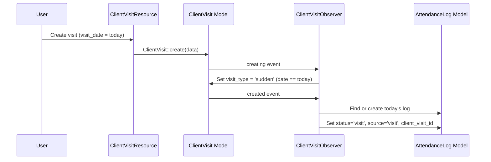

# Design Document: Sudden Client Visit Logic

## Overview

This feature adds automatic classification of client visits as "Planned" or "Sudden" based on the visit date, a Filament admin resource for managing client visits, and an observer that updates attendance records when a same-day (sudden) visit is created.

The system already has a `ClientVisit` model, an `AttendanceLog` model with `visit` status/source support, and a `client_visit_id` foreign key on `attendance_logs`. What's missing is:

1. A `visit_type` column on `client_visits` to classify visits
2. A `ClientVisitObserver` that auto-classifies visit type and updates attendance on same-day visits
3. A `ClientVisitResource` Filament admin panel for CRUD operations

## Architecture

The feature follows the existing Laravel/Filament patterns in the codebase:

- **Migration**: Adds `visit_type` string column to `client_visits` table
- **Model Update**: Adds `visit_type` to `$fillable`, adds type constants to `ClientVisit`
- **Observer**: `ClientVisitObserver` handles `creating` event (set visit_type) and `created` event (update/create AttendanceLog for same-day visits)
- **Filament Resource**: `ClientVisitResource` with form, table, and standard CRUD pages
- **Registration**: Observer registered in `AppServiceProvider::boot()`

## Components and Interfaces

### 1. Migration: `add_visit_type_to_client_visits_table`

Adds a `visit_type` string column to the existing `client_visits` table.

- Column: `visit_type` string, default `'planned'`, placed after `status`
- Backfill: Existing records get `'planned'` via the default

### 2. ClientVisit Model Updates

Add to the existing `App\Models\Hris\ClientVisit`:

- Constants: `TYPE_PLANNED = 'planned'`, `TYPE_SUDDEN = 'sudden'`
- Add `'visit_type'` to `$fillable` array
- Add `getVisitTypeLabels()` static method (mirrors existing `getStatusLabels()` pattern)

### 3. ClientVisitObserver

Location: `app/Observers/Hris/ClientVisitObserver.php`

**`creating(ClientVisit $visit): void`**

- Compares `$visit->visit_date` to `today()`
- Sets `$visit->visit_type` to `sudden` if equal, `planned` if future

**`created(ClientVisit $visit): void`**

- Only acts when `$visit->visit_type === 'sudden'`
- Finds existing `AttendanceLog` for `employee_id` + today's date using `forEmployee` and `forDate` scopes
- If found: updates `status`, `source`, `client_visit_id`
- If not found: creates new `AttendanceLog` with `status='visit'`, `source='visit'`, `date=today`, `client_visit_id`

### 4. ClientVisitResource

Location: `app/Filament/Resources/ClientVisitResource.php`

Follows the same pattern as `AttendanceLogResource`:

- Navigation group: `'HRIS'`
- Form: fields for `employee_id`, `client_name`, `client_address`, `purpose`, `purpose_detail`, `visit_date` (with `after_or_equal:today` rule), `planned_start_time`, `planned_end_time`, `notes`, `status`
- Table: columns for employee name, client name, visit date, visit type (badge), purpose, status
- Pages: List, Create, Edit

### 5. AppServiceProvider Registration

Add `ClientVisit::observe(ClientVisitObserver::class)` in the `boot()` method, following the existing `Ticket::observe()` pattern.

## Data Models

### client_visits table (existing + new column)

| Column              | Type          | Notes                                              |
| ------------------- | ------------- | -------------------------------------------------- |
| id                  | bigint        | PK, auto-increment                                 |
| employee_id         | foreignId     | FK to employees                                    |
| client_name         | string        | Required                                           |
| client_address      | string        | Required                                           |
| latitude            | decimal(10,8) | Nullable                                           |
| longitude           | decimal(11,8) | Nullable                                           |
| purpose             | enum          | One of the defined purpose constants               |
| purpose_detail      | string        | Nullable                                           |
| visit_date          | date          | Required, after_or_equal:today                     |
| planned_start_time  | time          | Nullable                                           |
| planned_end_time    | time          | Nullable                                           |
| actual_check_in     | timestamp     | Nullable                                           |
| actual_check_out    | timestamp     | Nullable                                           |
| notes               | text          | Nullable                                           |
| visit_report        | text          | Nullable                                           |
| photo_path          | string        | Nullable                                           |
| status              | enum          | planned, in_progress, completed, cancelled         |
| **visit_type**      | **string**    | **NEW — 'planned' or 'sudden', default 'planned'** |
| cancellation_reason | text          | Nullable                                           |
| timestamps          |               | created_at, updated_at                             |

### attendance_logs table (existing, relevant columns)

| Column          | Type      | Notes                                                                |
| --------------- | --------- | -------------------------------------------------------------------- |
| employee_id     | foreignId | FK to employees                                                      |
| client_visit_id | foreignId | Nullable, FK to client_visits (already exists)                       |
| date            | date      | The attendance date                                                  |
| status          | string    | 'present', 'late', 'half_day', 'absent', 'leave', 'holiday', 'visit' |
| source          | string    | 'web', 'mobile', 'biometric', 'import', 'visit'                      |

## Correctness Properties

_A property is a characteristic or behavior that should hold true across all valid executions of a system — essentially, a formal statement about what the system should do. Properties serve as the bridge between human-readable specifications and machine-verifiable correctness guarantees._

### Property 1: Future visit dates are classified as planned

_For any_ ClientVisit created with a `visit_date` strictly greater than today, the observer SHALL set `visit_type` to `'planned'`. We generate random future dates (1–365 days ahead) and verify the classification.

**Validates: Requirements 2.1**

### Property 2: Visit date validation rejects past dates

_For any_ date before today, attempting to create a ClientVisit (via API or Filament) SHALL fail validation. _For any_ date equal to today or in the future, validation SHALL pass. This consolidates the `after_or_equal:today` rule tested across both entry points.

**Validates: Requirements 3.2, 3.5, 6.1, 6.2**

### Property 3: Same-day visit updates existing attendance log

_For any_ employee who has an existing `AttendanceLog` record for today, when a ClientVisit is created with `visit_date` equal to today, the observer SHALL update that AttendanceLog's `status` to `'visit'`, `source` to `'visit'`, and `client_visit_id` to the new visit's ID.

**Validates: Requirements 4.2, 4.3, 4.4**

### Property 4: Same-day visit creates attendance log when none exists

_For any_ employee who does NOT have an `AttendanceLog` record for today, when a ClientVisit is created with `visit_date` equal to today, the observer SHALL create a new AttendanceLog with `status='visit'`, `source='visit'`, `date=today`, and `client_visit_id` set to the new visit's ID.

**Validates: Requirements 4.5**

### 6. Mobile App Updates

**`partnershub-app/frontend/services/api.ts`**: Add `visit_type: 'planned' | 'sudden'` to the `ClientVisit` interface.

**`partnershub-app/frontend/app/visit-request.tsx`**: Change default `visitDate` from `addDays(new Date(), 1)` to `new Date()` so employees can create same-day visits by default.

**`partnershub-app/frontend/app/visit-history.tsx`**: Add a visit type badge next to the status badge in `renderVisitCard`. Use red/danger for `sudden` and blue/info for `planned`.

## Error Handling

| Scenario                                       | Handling                                                                                |
| ---------------------------------------------- | --------------------------------------------------------------------------------------- |
| `visit_date` is in the past                    | Validation rejects with `after_or_equal:today` error (both API and Filament)            |
| `employee_id` does not exist                   | Foreign key constraint + Filament Select validation prevents invalid employee           |
| Observer fails to find/create AttendanceLog    | Log the error, do not prevent the ClientVisit from being created (graceful degradation) |
| Duplicate AttendanceLog for same employee+date | Use `firstOrCreate` pattern keyed on `employee_id` + `date` to prevent duplicates       |
| `visit_type` manually set to invalid value     | The observer overwrites `visit_type` during `creating`, so manual values are ignored    |

## Testing Strategy

### Property-Based Testing

The project uses **Pest** (v3.7) with `pestphp/pest-plugin-laravel`. Since no dedicated PBT library (like `phpunit-quickcheck`) is installed, property tests follow the existing pattern in the codebase: loop-based randomized tests with 100 iterations per property, using Faker for random data generation (as seen in `ProjectArchivePropertyTest.php`).

Each property test:

- Runs 100 iterations with randomized inputs
- References its design document property via a comment tag
- Uses `->group('property-test', 'sudden-client-visit-logic')` for filtering
- Tag format: `Feature: sudden-client-visit-logic, Property {N}: {title}`

### Unit Tests (Examples & Edge Cases)

Unit tests cover specific examples and structural requirements:

- **Migration test**: Verify `visit_type` column exists with default `'planned'`
- **Model constants test**: Verify `TYPE_PLANNED` and `TYPE_SUDDEN` constants exist
- **Model fillable test**: Verify `visit_type` is in `$fillable`
- **Observer registration test**: Verify `ClientVisitObserver` is registered in `AppServiceProvider`
- **Filament form fields test**: Verify the form contains all required fields
- **Filament table columns test**: Verify the table displays the required columns
- **Today's visit classification**: Creating a visit with today's date sets `visit_type` to `'sudden'`
- **Edge case — visit at midnight boundary**: Verify classification is correct at date boundaries

### Test File Locations

- Property tests: `tests/Feature/Hris/ClientVisitObserverPropertyTest.php`
- Unit tests: `tests/Unit/Hris/ClientVisitTest.php`
- Feature tests: `tests/Feature/Hris/ClientVisitResourceTest.php`
