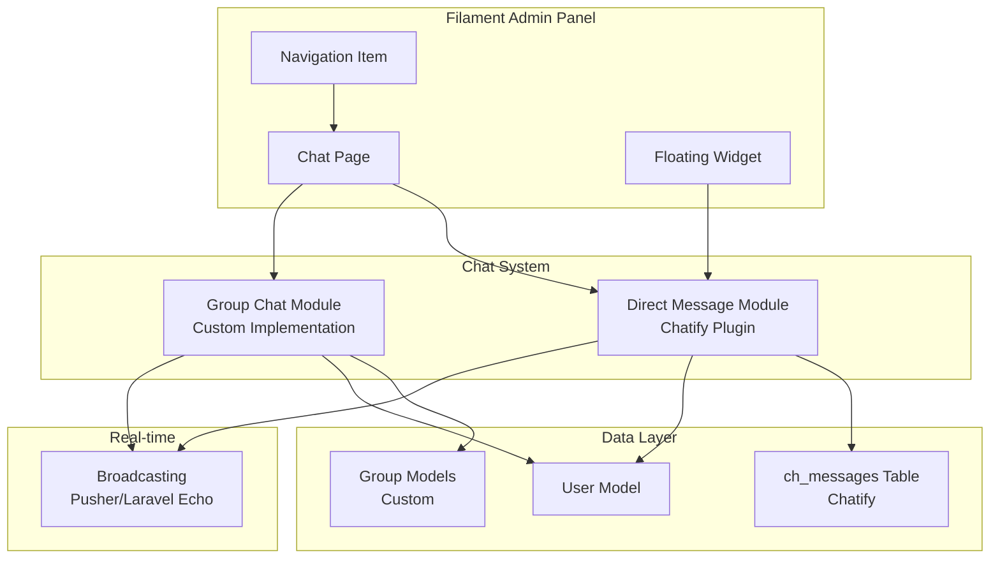

# Design Document: Team Chat

## Overview

This design document outlines the technical implementation of a real-time team chat messaging feature for the DewaKoding Project Management system. The solution leverages the Filament Chatify Integration plugin for direct messaging capabilities and extends it with custom group chat functionality.

The implementation consists of two main components:

1. **Direct Messaging** - Using the Filament Chatify Integration plugin (wrapping Chatify package)
2. **Group Chat** - Custom Laravel implementation extending the base functionality

## Architecture



## Components and Interfaces

### 1. Filament Chatify Integration (Direct Messaging)

**Package Installation:**

-   `monzer/filament-chatify-integration` - Filament plugin wrapper
-   `munafio/chatify` - Core chat functionality

**Components:**

-   `ChatifyPlugin` - Filament plugin registration
-   `CustomChatifyPage` - Extended chat page for customization
-   Floating chat widget (optional)

**Interface:**

```php
// Plugin registration in AdminPanelProvider
ChatifyPlugin::make()
    ->customPage(CustomChatifyPage::class)
    ->disableFloatingChatWidget() // Optional
```

### 2. Custom Chat Page

**Location:** `app/Filament/Pages/Chat.php`

```php
namespace App\Filament\Pages;

use Monzer\FilamentChatifyIntegration\Pages\Chatify as BaseChat;

class Chat extends BaseChat
{
    protected static ?string $slug = 'chat';
    protected static ?string $navigationLabel = 'Chat';
    protected static ?string $title = 'Chat';
    protected static ?string $navigationIcon = 'heroicon-o-chat-bubble-left-right';
    protected static ?string $navigationGroup = 'Communication';
    protected static ?int $navigationSort = 10;
}
```

### 3. Group Chat Service

**Location:** `app/Services/GroupChatService.php`

```php
interface GroupChatServiceInterface
{
    public function createGroup(string $name, array $memberIds, int $creatorId): ChatGroup;
    public function addMember(ChatGroup $group, int $userId, int $adminId): bool;
    public function removeMember(ChatGroup $group, int $userId, int $adminId): bool;
    public function sendMessage(ChatGroup $group, int $senderId, string $body): GroupMessage;
    public function getMessages(ChatGroup $group, int $userId): Collection;
    public function markAsRead(ChatGroup $group, int $userId): void;
    public function getUnreadCount(int $userId): int;
    public function getUserGroups(int $userId): Collection;
}
```

### 4. Group Chat Livewire Component

**Location:** `app/Livewire/GroupChat.php`

Handles real-time group chat interactions within the Filament panel.

## Data Models

### Chatify Tables (Provided by Package)

**ch_messages** - Direct messages between users
| Column | Type | Description |
|--------|------|-------------|
| id | bigint | Primary key |
| from_id | bigint | Sender user ID |
| to_id | bigint | Recipient user ID |
| body | text | Message content |
| attachment | string | File attachment path |
| seen | boolean | Read status |
| created_at | timestamp | Creation time |
| updated_at | timestamp | Update time |

**ch_favorites** - Favorite contacts
| Column | Type | Description |
|--------|------|-------------|
| id | bigint | Primary key |
| user_id | bigint | User ID |
| favorite_id | bigint | Favorited user ID |

### Custom Group Chat Tables

**chat_groups**
| Column | Type | Description |
|--------|------|-------------|
| id | bigint | Primary key |
| name | string | Group name (required) |
| description | text | Optional description |
| avatar | string | Group avatar path |
| created_by | bigint | Creator user ID (admin) |
| created_at | timestamp | Creation time |
| updated_at | timestamp | Update time |

**chat_group_members**
| Column | Type | Description |
|--------|------|-------------|
| id | bigint | Primary key |
| group_id | bigint | Foreign key to chat_groups |
| user_id | bigint | Foreign key to users |
| role | enum | 'admin' or 'member' |
| joined_at | timestamp | When user joined |
| last_read_at | timestamp | Last read timestamp |

**chat_group_messages**
| Column | Type | Description |
|--------|------|-------------|
| id | bigint | Primary key |
| group_id | bigint | Foreign key to chat_groups |
| user_id | bigint | Sender user ID |
| body | text | Message content |
| attachment | string | File attachment path |
| created_at | timestamp | Creation time |
| updated_at | timestamp | Update time |

### Eloquent Models

```php
// app/Models/ChatGroup.php
class ChatGroup extends Model
{
    protected $fillable = ['name', 'description', 'avatar', 'created_by'];

    public function members(): BelongsToMany
    public function messages(): HasMany
    public function creator(): BelongsTo
    public function admins(): BelongsToMany // where role = 'admin'
}

// app/Models/ChatGroupMember.php
class ChatGroupMember extends Pivot
{
    protected $table = 'chat_group_members';
    protected $casts = ['joined_at' => 'datetime', 'last_read_at' => 'datetime'];
}

// app/Models/GroupMessage.php
class GroupMessage extends Model
{
    protected $table = 'chat_group_messages';
    protected $fillable = ['group_id', 'user_id', 'body', 'attachment'];

    public function group(): BelongsTo
    public function sender(): BelongsTo
}
```

## Correctness Properties

_A property is a characteristic or behavior that should hold true across all valid executions of a system-essentially, a formal statement about what the system should do. Properties serve as the bridge between human-readable specifications and machine-verifiable correctness guarantees._

Based on the prework analysis, the following properties have been identified for property-based testing:

### Property 1: Message persistence round-trip

_For any_ valid message content sent between two users, querying the database should return a message with the same body, sender, and recipient.
**Validates: Requirements 1.3, 1.4**

### Property 2: Empty message rejection

_For any_ string composed entirely of whitespace characters (including empty string), attempting to send it as a message should be rejected and no message should be persisted.
**Validates: Requirements 1.5**

### Property 3: Unread count accuracy

_For any_ user with N unread messages across all conversations, the unread count calculation should return exactly N.
**Validates: Requirements 2.2**

### Property 4: Mark as read consistency

_For any_ conversation with unread messages, after marking as read, all messages in that conversation should have seen=true and unread count should be zero.
**Validates: Requirements 2.3**

### Property 5: User search filtering

_For any_ search query string and set of users, the search results should only contain users whose names contain the query string (case-insensitive).
**Validates: Requirements 5.1**

### Property 6: Group name requirement

_For any_ group creation attempt, if the name is empty or whitespace-only, creation should fail. If a valid name is provided with valid members, creation should succeed.
**Validates: Requirements 6.2**

### Property 7: Group message delivery

_For any_ group with N members and any message sent to that group, all N members should be able to retrieve that message from the group's message history.
**Validates: Requirements 6.3**

### Property 8: Group message sender attribution

_For any_ message in a group chat, the message record should contain the sender's user ID, and rendering should include the sender's name.
**Validates: Requirements 6.4**

### Property 9: Group visibility after membership

_For any_ user added to a group, querying that user's group list should include the newly joined group.
**Validates: Requirements 6.5**

### Property 10: Admin permission enforcement

_For any_ group, only users with admin role should be able to add or remove members. Non-admin member modification attempts should be rejected.
**Validates: Requirements 6.6**

### Property 11: Minimum group size validation

_For any_ group creation attempt with fewer than 2 members (excluding creator), creation should fail with a validation error.
**Validates: Requirements 6.7**

## Error Handling

| Error Scenario                         | Handling Strategy                                                       |
| -------------------------------------- | ----------------------------------------------------------------------- |
| Empty message submission               | Client-side validation + server-side rejection, return validation error |
| Unauthorized chat access               | Redirect to login via Filament auth middleware                          |
| Group creation without name            | Return validation error with message                                    |
| Group creation with < 2 members        | Return validation error with message                                    |
| Non-admin attempting member management | Return 403 Forbidden response                                           |
| Message to non-existent user/group     | Return 404 Not Found response                                           |
| Database connection failure            | Log error, display user-friendly message                                |
| Broadcasting failure                   | Fallback to polling, log error                                          |

## Testing Strategy

### Property-Based Testing Library

**fast-check** via Jest for JavaScript components, **Pest PHP** with custom generators for PHP backend.

For PHP property-based testing, we'll use a custom approach with Pest's dataset feature to generate random inputs.

### Unit Tests

-   ChatGroup model validation
-   GroupChatService methods
-   Message persistence
-   User search functionality
-   Permission checks

### Property-Based Tests

Each correctness property will be implemented as a property-based test:

-   Generate random valid/invalid inputs
-   Verify properties hold across 100+ iterations
-   Tag tests with property references: `**Feature: team-chat, Property {N}: {description}**`

### Integration Tests

-   Chat page authentication
-   Navigation routing
-   Plugin registration
-   Real-time message delivery (with mocked broadcasting)

### Test File Structure

```
tests/
├── Feature/
│   ├── ChatPageTest.php
│   ├── GroupChatPropertyTest.php
│   └── DirectMessagePropertyTest.php
└── Unit/
    ├── ChatGroupTest.php
    ├── GroupChatServiceTest.php
    └── GroupMessageTest.php
```
