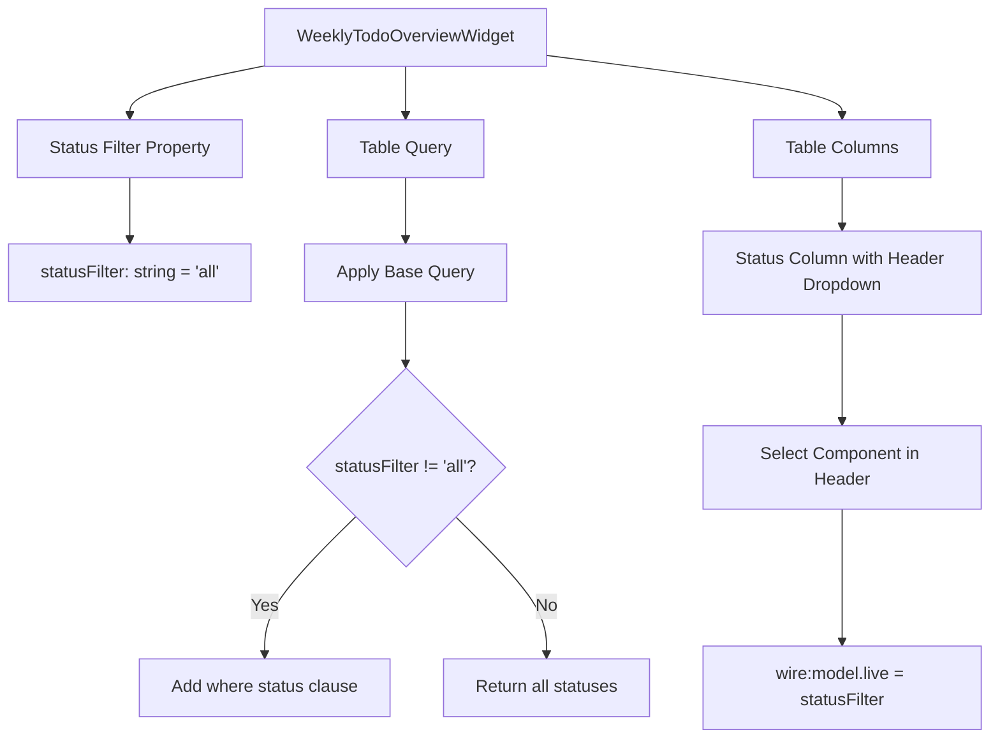

# Design Document: Weekly Todo Status Filter

## Overview

This feature enhances the Weekly To-Do List Overview widget by adding an interactive status filter dropdown directly in the column header. Instead of requiring users to open the filters panel, they can now filter by status (All, Pending, In Progress, Done) with a single click on the Status column header dropdown.

The implementation leverages Filament's Livewire-based table widget architecture, adding a public property to track the selected status filter and modifying the table query to apply the filter dynamically.

## Architecture



## Components and Interfaces

### WeeklyTodoOverviewWidget (Modified)

The existing widget will be enhanced with:

1. **New Public Property**: `$statusFilter` - Tracks the currently selected status filter
2. **Modified Query**: Applies status filter when not set to 'all'
3. **Custom Column Header**: Replaces static "Status" label with a dropdown select

```php
// New property
public string $statusFilter = 'all';

// Query modification
->when($this->statusFilter !== 'all', function ($query) {
    $query->where('status', $this->statusFilter);
})
```

### Status Filter Dropdown Component

A Blade component rendered in the column header using Filament's `Tables\Columns\TextColumn::make()->label()` with a custom view or inline HTML.

Options:

- `all` → "All" (default)
- `pending` → "Pending"
- `in_progress` → "In Progress"
- `done` → "Done"

## Data Models

No changes to existing data models. The feature uses the existing `WeeklyTodo` model with its `status` field which accepts values: `pending`, `in_progress`, `done`.

## Correctness Properties

_A property is a characteristic or behavior that should hold true across all valid executions of a system-essentially, a formal statement about what the system should do. Properties serve as the bridge between human-readable specifications and machine-verifiable correctness guarantees._

### Property 1: Status filter returns only matching todos

_For any_ status filter value (pending, in_progress, done), when applied to the widget query, all returned todos SHALL have a status matching the selected filter value.

**Validates: Requirements 1.3**

### Property 2: All filter returns todos of every status

_For any_ set of todos with mixed statuses, when the "all" filter is selected, the query SHALL return todos regardless of their status value.

**Validates: Requirements 1.4**

## Error Handling

| Scenario                         | Handling                                                |
| -------------------------------- | ------------------------------------------------------- |
| Invalid status filter value      | Default to 'all' - show all todos                       |
| Empty result set                 | Display Filament's empty state with appropriate message |
| Widget poll during filter change | Livewire handles state synchronization automatically    |

## Testing Strategy

### Property-Based Testing

The implementation will use **Pest PHP** with property-based testing patterns to verify correctness properties.

**Property Test Requirements:**

- Each property-based test MUST run a minimum of 100 iterations
- Each test MUST be tagged with the format: `**Feature: weekly-todo-status-filter, Property {number}: {property_text}**`
- Tests should generate random WeeklyTodo records with various statuses and verify filter behavior

### Unit Testing

Unit tests will cover:

- Default filter state on widget initialization
- Filter state persistence during Livewire lifecycle
- Query modification based on filter value

### Test Annotations

All property-based tests must reference the correctness property they implement:

```php
// **Feature: weekly-todo-status-filter, Property 1: Status filter returns only matching todos**
// **Validates: Requirements 1.3**
```
